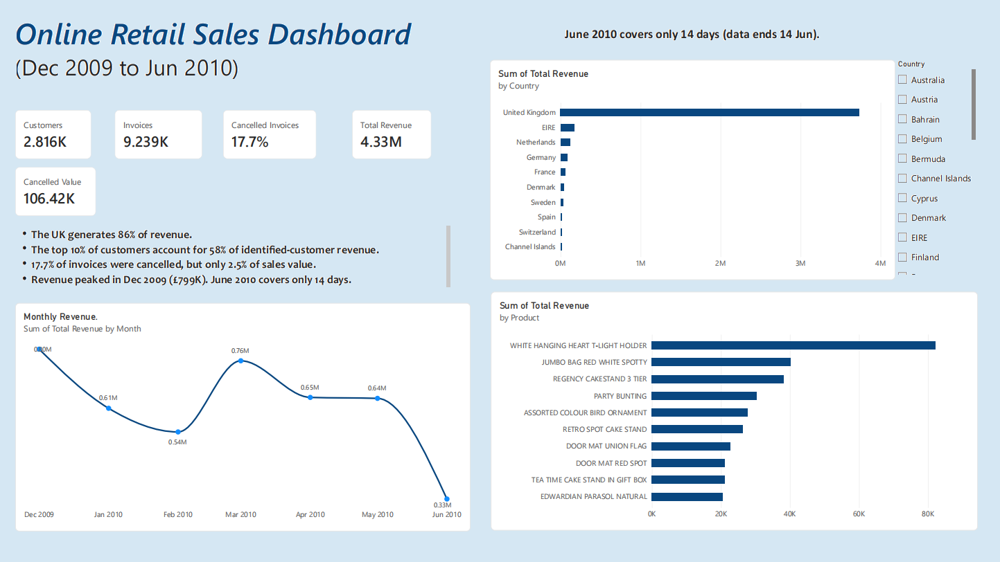

# Online Retail Sales Analysis (Python + Power BI)

End-to-end analysis of transactions from a UK online gift retailer: cleaning messy data, answering business questions, and presenting the results in an interactive dashboard.

## Business problem

The retailer wants to know which products and countries drive revenue, how much is lost to cancellations, how sales change over time, and how dependent the business is on its top customers.

## Dataset

- **Source:** [Online Retail II UCI on Kaggle](https://www.kaggle.com/datasets/mashlyn/online-retail-ii-uci)
- **Period analysed:** 1 Dec 2009 to 14 Jun 2010 (June is a partial month)
- **Size:** 235,812 raw rows, 8 columns (Invoice, StockCode, Description, Quantity, InvoiceDate, Price, Customer ID, Country)
- The raw data is not stored in this repository. Download it from the Kaggle link above.

## Tools

Python (Pandas) in Google Colab, Power BI Desktop

## Data cleaning

| Step | Rows affected | Reason |
|---|---|---|
| Removed exact duplicates | 2,829 | Repeated entries that would inflate revenue |
| Removed 1 broken row | 1 | Missing quantity, price and date |
| Separated cancelled invoices | 5,071 | Invoices starting with "C", analysed separately |
| Removed zero or negative quantity/price lines | 2,177 | Stock adjustments, not customer sales |
| Removed non-product codes | 1,007 | Postage, bank charges, discounts, manual entries and free items |
| Standardised product names by StockCode | n/a | The same code had up to 3 descriptions, which split revenue and changed the top-product ranking |

**Result:** 224,727 clean sales lines. Rows with no Customer ID (about 22% of rows) were kept for revenue analysis and excluded only from customer-level analysis, so revenue totals stay complete.

## Key findings

- **Revenue:** £4.33M over the period. It peaked in December 2009 (£799K), fell to £538K in February and recovered to £762K in March.
- **Products:** White Hanging Heart T-Light Holder is the top product (£82K), followed by Jumbo Bag Red White Spotty (£40K). The top 10 products make up only about 8% of revenue, so sales are spread across a wide catalogue.
- **Countries:** The UK generates 86% of revenue. The next largest markets are Ireland (EIRE), the Netherlands, Germany and France.
- **Customers:** The top 10% of customers (281 of 2,815) generate 58% of revenue from identified customers.
- **Cancellations:** 17.7% of invoices were cancelled, but only 2.5% of sales value, so cancellations are mostly many small orders.

## Limitations

- Only about 6.5 months of data, so yearly seasonality cannot be assessed. June 2010 covers 14 days only.
- About 22% of rows have no Customer ID, so customer findings apply to identified customers only.
- Revenue excludes postage, fees and adjustments.

## Repository contents

- `Notebook/` - Python notebook with cleaning and analysis
- `Dashboard/` - Power BI file (.pbix), PDF export and preview image

## Author

Pinninti Charishma Priya
